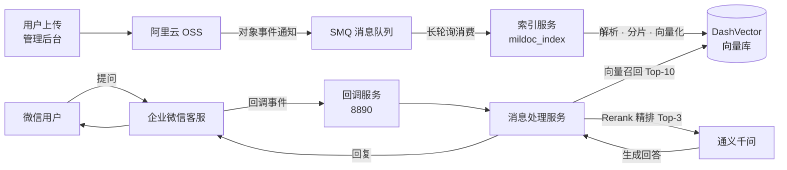

# MilDoc · 企业级 RAG 知识库与智能客服系统

面向企业场景的智能知识库平台：把分散的文档资产转化为可检索、可问答的知识中心，并通过**企业微信客服**对外提供智能问答服务。

> 项目状态：已在阿里云 ECS 部署运行，端到端问答链路实测可用

---

## 我完成的工作

- 完成阿里云 **OSS / 消息队列 SMQ / DashVector / 模型服务 / ECS / 企业微信客服** 的配置与全链路联调
- 搭建事件驱动的自动索引链路，实现文档上传后自动完成解析、分片与向量入库
- 实现「向量召回 → Rerank 精排 → LLM 生成」的两段式检索问答
- 完成企业微信客服接入：回调加解密、消息增量拉取、幂等去重、智能接待与转人工
- 保障消息可靠性：处理成功才确认，失败自动重投，超限才丢弃并记录
- 保障数据一致性：文档更新时全量清理旧向量再写入，避免残留脏数据
- 打通多轮对话上下文，使问答可承接指代与追问
- 接入 MinerU 高精度解析器，并实现解析失败自动回退
- 编写端到端演示脚本与修复验证脚本

---

## 架构



**三条核心链路**

| 链路 | 流程 |
|---|---|
| 文档入库 | 上传 → OSS 存储 → 事件通知 → 消息消费 → 解析分片 → 向量入库 |
| 智能问答 | 用户咨询 → 微信客服 → 向量召回 → Rerank 精排 → LLM 生成 → 回复 |
| 数据同步 | 文档删除 → OSS 清理 → 事件触发 → 向量库清理 |

---

## 核心设计

- **事件驱动索引**：以 OSS 对象事件为驱动，文档的创建 / 更新 / 删除自动同步到向量库，无需定时扫描
- **消息可靠性**：采用 at-least-once 语义，处理成功才确认消息；失败保留等待重投，超过重试上限才丢弃并记录，避免解析或调用抖动导致文档漏入库
- **索引一致性**：文档更新时先全量清理旧向量再写入，不受单次查询条数限制，重复上传不产生重复索引
- **两段式检索**：向量召回 Top-10 → Rerank 精排 Top-3 → LLM 生成，兼顾召回率与精准度
- **多轮上下文**：自动组装近期对话（含 AI 回复）注入 Prompt，支持指代与追问
- **解析器容错**：支持 PDF / Office / Markdown / Text，可选接入 MinerU 高精度解析；任一解析器失败自动回退到下一个，不因外部服务抖动中断索引
- **防幻觉约束**：Prompt 明确禁止编造，信息不足时主动声明并引导转人工
- **企微安全接入**：回调签名校验 + AES 解密；cursor + token 持久化实现增量拉取；msgid 唯一键保证幂等去重
- **会话状态机**：仅在智能接待态自动应答，识别「转人工」后自动转接接待池或指定客服

---

## 技术栈

| 层次 | 选型 |
|---|---|
| 存储 | 阿里云 OSS |
| 消息 | 阿里云 SMQ / MNS |
| 向量库 | 阿里云 DashVector（768 维 / cosine / float） |
| 模型 | text-embedding-v4 · qwen3-rerank · qwen3.8-flash |
| 数据库 | MySQL · Redis |
| 后端 | Python · Flask · Gunicorn（gthread 2×4） |
| 部署 | 阿里云 ECS · uv |

---

## 快速开始

### 1. 环境准备

```bash
git clone <本仓库>
cd mildoc-202610
uv sync
cp .env.example .env
```

### 2. 配置云服务

在 `.env` 中填入以下服务的凭据（均需自行开通）：

- 阿里云 **OSS**：`OSS_ACCESS_KEY_ID` / `OSS_ACCESS_KEY_SECRET` / `OSS_BUCKET`，并在控制台配置对象事件通知
- 阿里云 **SMQ**：`MNS_ACCESS_KEY_ID` / `MNS_ACCESS_KEY_SECRET` / `MNS_QUEUE_NAME`
- 阿里云 **DashVector**：`DASHVECTOR_API_KEY` / `DASHVECTOR_ENDPOINT`，创建 Collection（768 维 / cosine）
- 通义千问：`DASHSCOPE_API_KEY`，配置 embedding / rerank / LLM 模型名
- 企业微信：`WECOM_CORP_ID` / `WECOM_AGENT_ID` / `WECOM_APP_SECRET` / `WECOM_TOKEN` / `WECOM_ENCODING_AES_KEY`
- 可选 **MinerU**：`MINERU_SERVER_URL`，配置后 PDF 优先使用高精度解析，未配置时行为不变

### 3. 初始化并启动

```bash
# 初始化数据库
sudo mysql -u root -f < docs/script/mildoc_schema.sql

# 启动服务
cd mildoc_index  && ./run_index.sh           # 索引服务
cd mildoc_admin  && ./run_admin.sh           # 管理后台 :8870
cd mildoc_wxkf   && ./run_wxkf_callback.sh   # 企微回调 :8890
cd mildoc_wxkf   && ./run_wxkf_handler.sh    # 消息处理
```

> 若使用 `su` 切换用户启动，需先 `export PATH=/home/<user>/.local/bin:$PATH`，否则找不到 `uv`。

### 4. 验证链路

```bash
python demo/demo_flow.py                      # 只读演示（知识库状态 + 一次问答）
python demo/demo_flow.py --upload             # 完整链路（上传 → 索引 → 自动清理）
python demo/demo_flow.py --query "你的问题"    # 指定问题
python tests/verify_fixes.py                  # 核心逻辑验证
```

---

## 目录结构

```
.
├── mildoc_admin/     # 管理后台（Flask）：目录管理、文件上传、分片查看、会话浏览
├── mildoc_index/     # 索引服务：消费 OSS 事件、解析、分片、向量化
│   └── parser/       # 文档解析器：PDF / Office / Markdown / Text / MinerU
├── mildoc_wxkf/      # 微信客服：回调验签、消息同步、RAG 问答、会话状态机
├── docs/script/      # 数据库建表脚本
├── demo/             # 端到端演示脚本
└── tests/            # 核心逻辑验证脚本
```

---

## 说明

- 云服务凭据均通过 `.env` 管理，仓库不包含任何密钥
- 演示与验证脚本只输出配置项「是否已配置」，不打印任何敏感值
- 数据库与向量库中的示例文档仅用于功能验证
